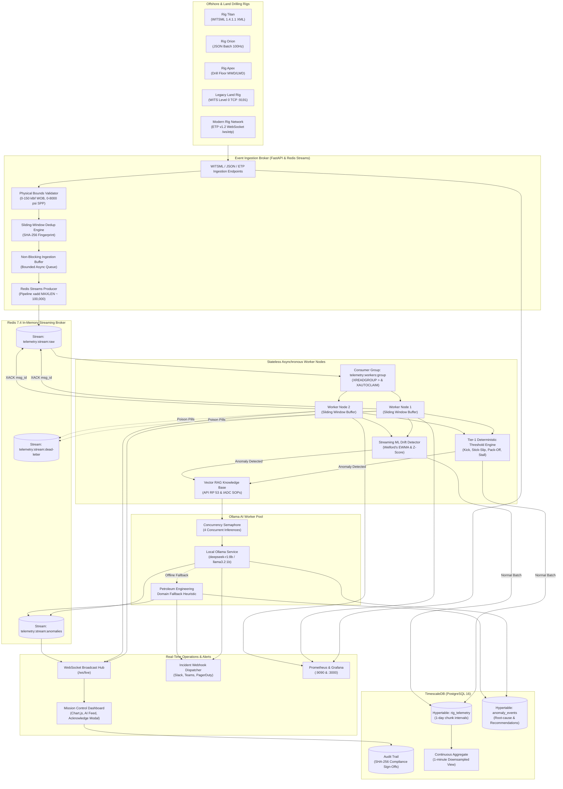

# Event-Driven Telemetry Mesh

> A high-throughput, fault-tolerant distributed streaming architecture that uses Redis Streams to decouple real-time WITSML rig sensor ingestion from asynchronous AI inference workers.


---

## Why This Exists

Commercial drilling rigs stream high-frequency MWD/LWD telemetry at 50–100 Hz across hundreds of channels (Weight on Bit, Torque, RPM, Standpipe Pressure, Flow Rates). Coupling these mission-critical data streams directly to large language models or cloud APIs introduces three catastrophic failure modes:

1. **Backpressure bottlenecks & data loss**: LLM inference latencies (100–1500 ms) block real-time sensor processing loops, causing buffer exhaustion and dropped telemetry frames.
2. **Data leakage & cloud dependency**: Transmitting proprietary downhole geological and formation data over cloud endpoints violates enterprise IP and fails during remote satellite (VSAT) communications blackouts.
3. **Lack of deterministic safety guarantees**: Hallucinations or inference delays during catastrophic well-control incidents (kicks, annular pack-offs, twist-offs) cannot be tolerated.

**Event-Driven Telemetry Mesh solves all three.**

* **Local-First & Air-Gapped**: Runs entirely on-premise or edge rig servers with zero external telemetry transmission.
* **Two-Tier Safety Engine**: Tier-1 deterministic physics evaluations (<1 ms) trigger immediate shutdowns; Tier-2 asynchronous Ollama LLMs perform deep causal reasoning out-of-band.
* **Decoupled via Redis Streams**: Non-blocking ingestion pipelines absorb bursts at thousands of records per second while consumer groups scale horizontally with automatic message reclamation (`XAUTOCLAIM`).

---

## System Architecture

### ASCII Topology Overview

```
                                WELLSITE SENSOR SOURCES
          [Rig Titan]          [Rig Orion]         [Legacy Land Rig]     [Modern Rig]
       (WITSML 1.4 XML)        (JSON Batch)         (WITS0 TCP:9191)     (ETP v1.2 WS)
               │                   │                        │                 │
               └───────────────────┴───────────┬────────────┴─────────────────┘
                                               ▼
                              ┌───────────────────────────────────┐
                              │    Ingestion Broker (Port 8000)   │
                              │  - Bounds & Sanity Validation     │
                              │  - Deduplication Engine (SHA-256) │
                              │  - Bounded Async Memory Buffer    │
                              └─────────────────┬─────────────────┘
                                                │ Pipelined XADD
                                                ▼
                         ┌──────────────────────────────────────────────┐
                         │      Redis 7.4 In-Memory Streaming Mesh      │
                         │  - telemetry:stream:raw  (Trimmed MAXLEN)    │
                         │  - telemetry:stream:anomalies                │
                         │  - telemetry:stream:dead-letter (DLQ)        │
                         └──────────────────────┬───────────────────────┘
                                                │
                     ┌──────────────────────────┴──────────────────────────┐
                     │ XREADGROUP (telemetry:workers:group)                │ XAUTOCLAIM
                     ▼                                                     ▼
        ┌─────────────────────────┐                           ┌─────────────────────────┐
        │  Stream Worker Node 1   │                           │  Stream Worker Node 2   │
        │ - Sliding Window Buffer │                           │ - Sliding Window Buffer │
        │ - MSE / ECD / Trajectory│                           │ - MSE / ECD / Trajectory│
        │ - Tier-1 Thresholds     │                           │ - Tier-1 Thresholds     │
        │ - Streaming ML Detector │                           │ - Streaming ML Detector │
        └────────────┬────────────┘                           └────────────┬────────────┘
                     │                                                     │
                     └──────────────────────────┬──────────────────────────┘
                                                │ (Normal Batch)
                                                ├─────────────────────────┐
                                                │ (Anomaly Detected)      │
                                                ▼                         ▼
                                ┌──────────────────────────┐   ┌────────────────────────┐
                                │   Ollama LLM Reasoning   │   │ TimescaleDB (Postgres) │
                                │ - DeepSeek-R1 / Fallback │   │ - rig_telemetry (1-day)│
                                │ - RAG (API RP 53 / IADC) │   │ - anomaly_events (7-d) │
                                │ - Concurrency Semaphore  │   │ - Continuous Aggregates│
                                └────────────┬─────────────┘   └──────────┬─────────────┘
                                             │                            │
                                             ▼                            ▼
                                ┌───────────────────────────────────────────────────────┐
                                │            Operational Mission Control                │
                                │ - Real-Time Web Dashboard (/ws/live)                  │
                                │ - Prometheus Metrics (/metrics on :8000 & :9090)      │
                                │ - Grafana Turnkey Operations (:3000)                  │
                                │ - Webhook Dispatcher (Slack / Teams / PagerDuty)      │
                                └───────────────────────────────────────────────────────┘
```

### Detailed Mermaid Workflow



---

## Directory Structure

The repository follows a clean, standardized layout:

```
event-driven-telemetry-mesh/
├── src/                          # Standard application source code root
│   └── telemetry_mesh/           # Core streaming telemetry package
│       ├── api/                  # FastAPI app, REST routes, WebSockets, dashboard
│       ├── broker/               # Redis Streams producer, consumer, DLQ, dedup
│       ├── ingestion/            # WITSML XML, JSON, WITS0 TCP, ETP v1.2, simulator
│       ├── models/               # Pydantic v2 schemas for sensors, WITSML, anomalies
│       ├── persistence/          # TimescaleDB pool, repository, compliance audit
│       ├── workers/              # Physics engine, thresholds, RAG, Ollama pool, worker node
│       └── config.py             # Pydantic BaseSettings application configuration
├── configs/                      # Infrastructure & service configuration templates
│   ├── telemetry_mesh.env        # Annotated environment configuration template
│   ├── prometheus/               # Prometheus scraper configuration
│   ├── timescaledb/              # Database schema & TimescaleDB hypertable DDL
│   └── grafana/                  # Turnkey Mission Control dashboards & datasources
├── docker/                       # Container infrastructure & deployment assets
│   ├── Dockerfile                # Production multi-stage Docker container specification
│   ├── docker-compose.yml        # Turnkey 7-container operational cluster
│   ├── docker-compose.dev.yml    # Development overlay with live reloading
│   ├── entrypoint.sh             # Container bootstrap and signal trapping script
│   └── .dockerignore             # Strict container build exclusion manifest
├── docs/                         # Engineering documentation & architecture records
│   ├── adr/                      # Architecture Decision Records (0001-0004)
│   ├── architecture.md           # Deep-dive system topology & decoupling design
│   ├── development.md            # Local developer workflows & test commands
│   └── security.md               # Threat modeling, secrets & network isolation
├── scripts/                      # Tooling, seed generators, benchmarks & TUI
│   ├── benchmark_pipeline.py     # Micro-batch throughput & latency benchmark suite
│   ├── init_timescaledb.sql      # Database initialization script
│   ├── run_dev.sh                # Local uvicorn development launcher
│   ├── seed_synthetic_stream.py  # Standalone synthetic stream generator
│   └── telemetry_tui.py          # ANSI terminal mission control monitor
├── tests/                        # 46 automated unit and end-to-end integration tests
│   ├── conftest.py               # Shared test fixtures & in-memory fakeredis client
│   ├── test_api_and_websocket.py # REST endpoints, WebSocket broadcast & simulator triggers
│   ├── test_audit_and_prometheus.py # Metrics export & cryptographic signature validation
│   ├── test_config.py            # Application settings and environment overrides
│   ├── test_dlq_and_dedup.py     # SHA-256 deduplication & dead-letter queue routing
│   ├── test_end_to_end.py        # Full pipeline integration with Ollama fallback
│   ├── test_ml_and_rag.py        # Welford's algorithm drift detection & vector RAG
│   ├── test_ollama_pool.py       # LLM concurrency semaphore & domain heuristic fallback
│   ├── test_physics_engine.py    # MSE, ECD, d-exponent physics calculations
│   ├── test_redis_pipeline.py    # Producer backpressure & consumer group batching
│   ├── test_simulator.py         # Multi-rig state generator & anomaly injection
│   ├── test_sliding_window.py    # Per-rig circular buffers & rolling statistics
│   ├── test_threshold_engine.py  # Deterministic safety rule triggers (kick, stall, etc.)
│   ├── test_trajectory_engine.py # Minimum Curvature 3D directional calculations
│   ├── test_webhook_dispatcher.py# Multi-channel emergency webhook notifications
│   ├── test_wits0_and_etp.py     # Legacy WITS0 TCP stream & ETP v1.2 frames
│   └── test_witsml_parser.py     # WITSML 1.4 XML roundtrip & physical range validator
├── .env.example                  # Exhaustive environment variable specification
├── .gitignore                    # Strict gitignore covering caches, secrets & artifacts
├── docker-compose.yml            # Root docker-compose entrypoint
├── Dockerfile                    # Root multi-stage Docker build entrypoint
├── Makefile                      # Standardized build, test, and lifecycle automation
└── pyproject.toml                # PEP 621 Python project packaging configuration
```

---

## Quickstart

### Prerequisites
* Docker Engine 24+ & Docker Compose v2 (recommended) **OR**
* Python 3.10+ with Redis 7+ and PostgreSQL 16+ (TimescaleDB)

### 1. Launch with Docker Compose (Recommended)

Start the full 7-container cluster with one command:

```bash
# Clone the repository
git clone https://github.com/kirk-keel/event-driven-telemetry-mesh.git
cd event-driven-telemetry-mesh

# Initialize environment configuration
cp -n .env.example .env

# Launch cluster in background
docker compose up -d --build
```

Verify service health:
```bash
curl http://localhost:8000/api/v1/health
```

### 2. Available Ports & Services

| Service | Endpoint | Description |
|---|---|---|
| **Mission Control Dashboard** | [http://localhost:8000](http://localhost:8000) | Real-time sensor charts, AI alerts, and anomaly management |
| **Grafana Operations** | [http://localhost:3000](http://localhost:3000) | Turnkey Grafana monitoring (`admin` / `admin`) |
| **Prometheus Metrics** | [http://localhost:9090](http://localhost:9090) | Prometheus scraper querying `/metrics` |
| **WITS Level 0 TCP Port** | `tcp://localhost:9191` | Direct TCP socket for legacy mud-logging sensor feeds |
| **ETP v1.2 WebSocket** | `ws://localhost:8000/ws/etp` | Energistics Transfer Protocol real-time streaming channel |
| **Live WebSocket Stream** | `ws://localhost:8000/ws/live` | Browser UI real-time JSON event broadcast |

### 3. Local Development (Without Docker)

```bash
# Create and activate virtual environment
python3 -m venv .venv
source .venv/bin/activate

# Install dependencies in editable mode
make setup

# Run the full automated test suite (46 tests)
make test

# Launch the API and local simulator
./scripts/run_dev.sh
```

---

## Digital Twin Physics & Directional Trajectory

The telemetry worker pipeline continuously calculates petroleum engineering parameters alongside raw sensor streams:

* **Teale's Mechanical Specific Energy (MSE)**:
  $$\text{MSE} = \frac{\text{WOB}}{A_b} + \frac{13.33 \times \text{RPM} \times \text{Torque}}{A_b \times \text{ROP}}$$
  Quantifies rock-destruction efficiency ($\text{kpsi}$) in real time to identify bit balling, cutter wear, or lithology transitions.

* **Equivalent Circulating Density (ECD)**:
  $$\text{ECD} = \text{MW} + \frac{\Delta P_{\text{annular}}}{0.052 \times \text{TVD}}$$
  Monitors dynamic downhole mud pressure to ensure wellbore pressure remains within the safe drilling window (between pore pressure and fracture gradient).

* **Corrected $d$-Exponent ($d_{\text{xc}}$)**:
  $$d_{\text{xc}} = \frac{\log_{10}(\frac{\text{ROP}}{60 \times \text{RPM}})}{\log_{10}(\frac{12 \times \text{WOB}}{10^6 \times D_b})} \times \frac{\text{Normal Mud Weight}}{\text{Actual Mud Weight}}$$
  Detects abnormal formation overpressures **prior to gas or fluid kicks reaching the rig floor**.

* **Minimum Curvature Directional Trajectory**:
  Calculates continuous 3D wellbore trajectory $(\text{North}, \text{East}, \text{TVD})$ and Dogleg Severity ($\text{DLS}$ in $^\circ/100\text{ ft}$) from downhole MWD inclination and azimuth surveys.

---

## Testing & Quality Assurance

The codebase includes 46 unit and integration tests covering every subsystem:

```bash
# Execute tests with verbose reporting
make test
```

Expected output:
```
============================= test session starts ==============================
rootdir: /home/kirk/projects/event-driven-telemetry-mesh
configfile: pyproject.toml
testpaths: tests
plugins: anyio-4.15.1, asyncio-1.4.0
collected 46 items

tests/test_api_and_websocket.py .....                                    [ 10%]
tests/test_audit_and_prometheus.py ..                                    [ 15%]
tests/test_config.py ..                                                  [ 19%]
tests/test_dlq_and_dedup.py ..                                           [ 23%]
tests/test_end_to_end.py .                                               [ 26%]
tests/test_ml_and_rag.py ..                                              [ 30%]
tests/test_ollama_pool.py ..                                             [ 34%]
tests/test_physics_engine.py ....                                        [ 43%]
tests/test_redis_pipeline.py ..                                          [ 47%]
tests/test_simulator.py ....                                             [ 56%]
tests/test_sliding_window.py ...                                         [ 63%]
tests/test_threshold_engine.py ......                                    [ 76%]
tests/test_trajectory_engine.py ..                                       [ 80%]
tests/test_webhook_dispatcher.py ..                                      [ 84%]
tests/test_wits0_and_etp.py ...                                          [ 91%]
tests/test_witsml_parser.py ....                                         [100%]

============================== 46 passed in 1.47s ==============================
```

Additional commands:
```bash
make bench      # Execute high-throughput micro-batch latency benchmarks
make tui        # Launch ANSI terminal mission control console
make lint       # Ruff lint check
make fmt        # Ruff auto-formatter
make security   # Gitleaks secret detection
```

---

## Security Model

| Dimension | Implementation |
|---|---|
| **Network Isolation** | Local-first; internal bridge network (`mesh-net`); zero external telemetry transmission |
| **Inference Privacy** | 100% on-premise local Ollama execution (`deepseek-r1:8b`); no cloud LLM API dependencies |
| **Secret Management** | Strict `.gitignore`; `.env.example` templates; pre-commit secret detection |
| **Container Hardening** | Unprivileged container execution (`USER appuser:1000`); minimal Debian slim base |
| **Memory & Flow Safety** | Bounded async queues, stream trimming (`MAXLEN ~ 100,000`), Dead-Letter Queue (DLQ) |
| **Compliance & Audit** | Cryptographic SHA-256 audit signatures on operational acknowledgments and mitigations |

---

## Contributing

See [CONTRIBUTING.md](CONTRIBUTING.md) for contribution guidelines, coding standards, and pull request procedures.

---

## License

Licensed under the Apache License, Version 2.0. See [LICENSE](LICENSE) for full terms.
