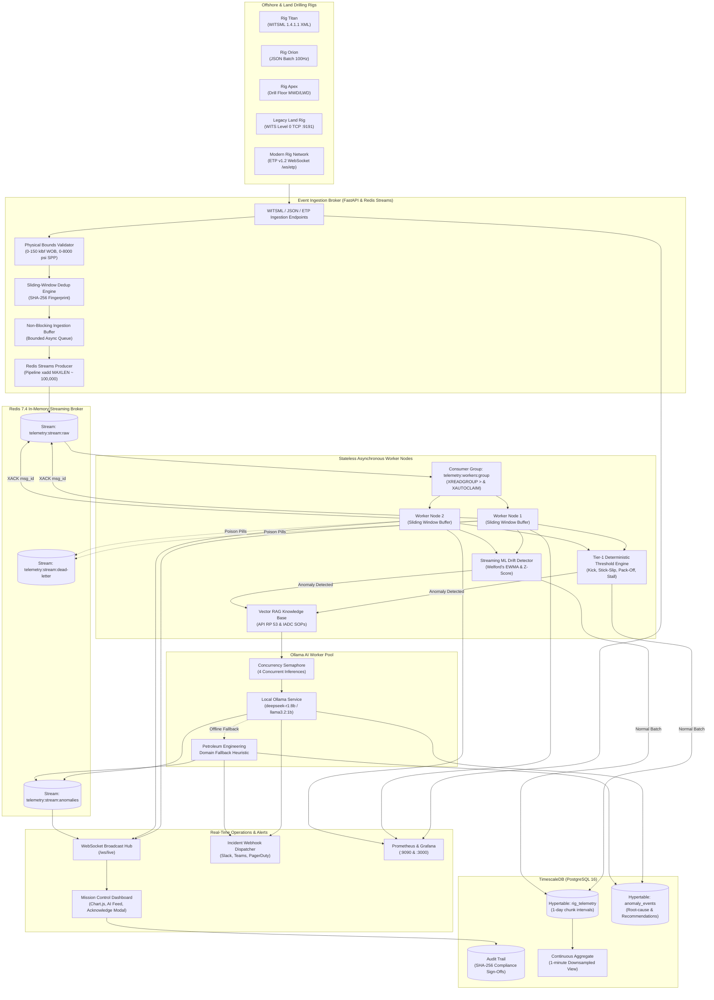

# Event-Driven Telemetry Mesh

> A high-throughput, fault-tolerant distributed streaming architecture that uses Redis Streams to decouple real-time WITSML rig sensor ingestion from asynchronous AI inference workers.


## Why this exists

Commercial drilling rigs stream high-frequency MWD/LWD telemetry at 50–100 Hz across hundreds of channels (WOB, Torque, RPM, Standpipe Pressure, Flow Rates). Coupling these mission-critical data streams directly to large language models or cloud APIs introduces three critical points of failure:
1. **Backpressure bottlenecks & data loss**: LLM inference latencies (100–1500 ms) block real-time sensor processing pipelines.
2. **Data leakage & cloud dependency**: Transmitting proprietary downhole geological and formation data over cloud endpoints violates enterprise IP and fails during remote satellite (VSAT) communications blackouts.
3. **Lack of deterministic safety guarantees**: Hallucinations or inference delays during catastrophic well-control incidents (kicks, annular pack-offs) cannot be tolerated.

**Event-Driven Telemetry Mesh solves all three.**

**Local-first. Sub-millisecond deterministic safety tier. Decoupled via Redis Streams. Air-gapped AI reasoning.**

---

## Architecture



---

## Security Model

| Concern | Default |
| :--- | :--- |
| **Network exposure** | Local-first; internal bridge network; zero public telemetry transmission |
| **Inference privacy** | Air-gapped; 100% on-premise local Ollama execution |
| **Secrets** | `.env` gitignored; `.env.example` template; pre-commit secret scanning |
| **Containers** | Non-root unprivileged execution (`appuser:1000`) |
| **Memory safety** | Bounded async queues, approximate stream trimming (`MAXLEN ~ 100,000`), dead-letter queues |
| **Compliance & Audit** | Operational driller mitigations signed with SHA-256 cryptographic hashes |

---

## Project Structure

```
├── telemetry_mesh/           core application package
│   ├── api/                  FastAPI app, REST routes, WebSockets, dashboard
│   ├── broker/               Redis Streams producer, consumer, DLQ, dedup
│   ├── ingestion/            WITSML XML, JSON, WITS0 TCP, ETP v1.2, simulator
│   ├── models/               Pydantic data models for sensors, WITSML, anomalies
│   ├── persistence/          TimescaleDB connection pool, repository, audit trail
│   └── workers/              Stream workers, threshold engine, physics, RAG, Ollama
├── docs/                     architecture, security, development, ADRs
│   ├── adr/                  Architecture Decision Records (0001-0004)
│   ├── architecture.md       detailed system topology & decoupling design
│   ├── development.md        development setup & workflow tasks
│   └── security.md           threat model & network exposure
├── scripts/                  benchmarks, synthetic seeds, TUI dashboard, init SQL
├── provisioning/             turnkey Grafana dashboards & Prometheus scrapers
├── tests/                    complete unit and end-to-end integration test suite
├── .github/workflows/        CI/CD automation workflows
├── Makefile                  standardized build & test automation
├── docker-compose.yml        multi-container orchestration
└── Dockerfile                hardened multi-stage container
```

---

## Quick Start

```bash
git clone https://github.com/kirk-keel/event-driven-telemetry-mesh.git
cd event-driven-telemetry-mesh
cp -n .env.example .env
make setup
make up
```

Verify health:
```bash
curl http://localhost:8000/api/v1/health
```

Access services:
* **Mission Control Web Dashboard**: [http://localhost:8000](http://localhost:8000)
* **Grafana Operations**: [http://localhost:3000](http://localhost:3000) (User/Pass: `admin`/`admin`)
* **Prometheus Metrics**: [http://localhost:9090](http://localhost:9090) or [http://localhost:8000/metrics](http://localhost:8000/metrics)
* **WITS Level 0 Ingestion**: Raw TCP socket on port `9191`
* **ETP v1.2 WebSockets**: `ws://localhost:8000/ws/etp`

---

## Configuration

Secrets and environment variables live in `.env` (see `.env.example`). Non-secret settings and physical drilling threshold limits live in `telemetry_mesh/config.py`.

---

## Development

```bash
make test       # Run 40 automated tests
make bench      # Execute throughput & latency benchmark suite
make tui        # Launch ANSI terminal mission control
make lint       # Ruff code linting
make fmt        # Ruff auto-formatting
make security   # Gitleaks secret scanning
```

---

## Digital Twin Physics & Directional Trajectory

The worker pipeline continuously evaluates foundational downhole petroleum engineering metrics alongside sensor streams:
* **Teale's Mechanical Specific Energy (MSE)**:
  $$\text{MSE} = \frac{\text{WOB}}{A_b} + \frac{13.33 \times \text{RPM} \times \text{Torque}}{A_b \times \text{ROP}}$$
  Evaluates rock-destruction efficiency ($\text{kpsi}$) in real time to detect bit balling and cutter wear.
* **Equivalent Circulating Density (ECD)**:
  $$\text{ECD} = \text{MW} + \frac{\Delta P_{\text{annular}}}{0.052 \times \text{TVD}}$$
  Monitors dynamic downhole mud pressure to prevent exceeding formation fracture gradients.
* **Corrected $d$-Exponent ($d_{\text{xc}}$)**:
  Identifies formation overpressure zones **before fluid kicks reach the wellhead**.
* **Minimum Curvature Directional Trajectory**:
  Calculates continuous 3D well paths $(\text{North}, \text{East}, \text{TVD})$ and Dogleg Severity ($\text{DLS}$ in $^\circ/100\text{ ft}$) from MWD survey stations.

---

## Roadmap

- [x] Redis Streams pipelined producer with approximate trimming
- [x] Consumer groups with horizontal scaling and automatic failure reclaim (`XAUTOCLAIM`)
- [x] Multi-protocol ingestion: WITSML 1.3.1/1.4.1.1 XML, JSON, WITS0 TCP, ETP v1.2 WebSockets
- [x] Dead-Letter Queue (DLQ) with poison-pill isolation and replay
- [x] Two-tier deterministic physics & streaming ML drift detector
- [x] Hierarchical Ollama LLM cascading with vector RAG grounded in API Standard 53
- [x] TimescaleDB partitioned hypertables & continuous aggregates
- [x] Native Prometheus metrics & turnkey Grafana provisioning
- [x] Directional 3D wellbore trajectory engine (Minimum Curvature)
- [x] Emergency alert webhooks (Slack, Teams, PagerDuty)
- [x] Cryptographic compliance audit trail sign-offs
- [x] Real-time Mission Control Web Dashboard & ANSI Terminal TUI

---

## Contributing

See [CONTRIBUTING.md](CONTRIBUTING.md).

---

## License

Apache-2.0 — see [LICENSE](LICENSE).
