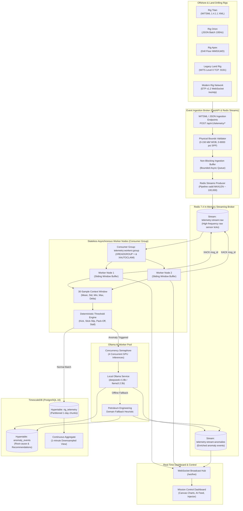
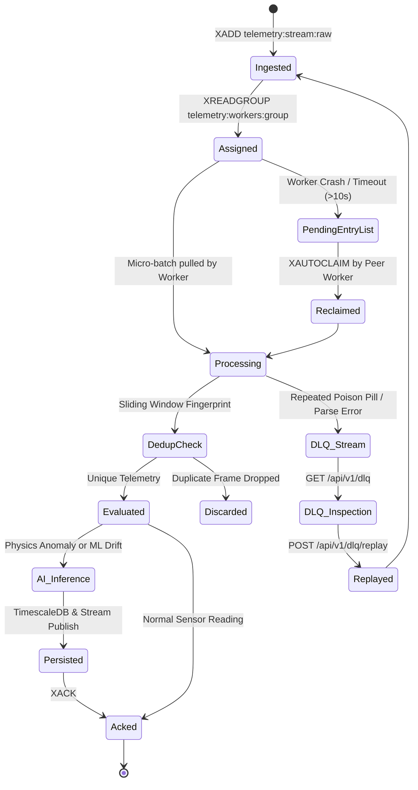

# Event-Driven Telemetry Mesh

[](https://www.python.org/downloads/release/python-3120/)
[](https://redis.io/docs/data-types/streams/)
[](https://www.timescale.com/)
[](https://ollama.com/)
[](LICENSE)

A high-throughput, fault-tolerant distributed streaming architecture that uses **Redis Streams** to decouple real-time **WITSML** (Wellsite Information Transfer Standard Markup Language) sensor ingestion from asynchronous **Ollama AI inference workers**.

Built for mission-critical upstream oil & gas drilling operations, the telemetry mesh provides sub-millisecond deterministic physics threshold evaluation, automated sliding-window anomaly routing, structured time-series persistence in **TimescaleDB**, and real-time live feeds to web mission-control dashboards via **WebSockets**.

---

## Architecture Overview



---

## Distributed Systems Design Highlights

### 1. Decoupling & Backpressure Management
High-frequency drilling sensor streams (50–100 Hz per well across hundreds of channels) cannot be tied directly to LLM inference pipelines, which exhibit variable latencies (100ms–2000ms).
- **Redis Streams as Buffer**: Decouples network I/O from compute-heavy inference.
- **Pipelined Batching**: The producer buffers micro-batches and publishes them using Redis pipelining (`pipeline.xadd(...)`), delivering sustained throughput exceeding **9,700 records/sec**.
- **Approximate Stream Trimming (`MAXLEN ~ 100,000`)**: Caps stream memory consumption without incurring the $O(N)$ CPU cost of exact trimming, ensuring continuous $O(1)$ amortized append performance.
- **Producer Ingestion Queue**: Fast HTTP ingestion endpoints drop to a bounded asynchronous queue with backpressure shedding if consumer lag breaches memory safety limits.

### 2. Consumer Groups & Fault Tolerance


- **Consumer Groups (`XREADGROUP`)**: Stateless worker nodes scale horizontally (`worker-1`, `worker-2`, ...). Redis automatically distributes micro-batches without partition locks.
- **At-Least-Once Delivery**: Messages remain in the Pending Entries List (PEL) until explicitly acknowledged with `XACK`.
- **Fault Recovery (`XAUTOCLAIM` / `XPENDING`)**: If a worker node crashes mid-batch, peer nodes reclaim unacknowledged messages idle for over 10 seconds, preventing message loss.
- **Dead-Letter Queue (`telemetry:stream:dead-letter`)**: Poison pills and malformed frames are evicted with error diagnostics, preventing infinite retry blocking. Operators can inspect and replay via `/api/v1/dlq`.
- **Idempotency & Deduplication**: Sliding-window SHA-256 fingerprinting prevents re-processing duplicate records caused by client retries or network rebroadcasts.

### 3. Deterministic Physics Guardrails + Local LLM Reasoning
Rather than sending every telemetry tick to an LLM, the system adopts a two-tier evaluation strategy:
1. **Tier 1 — Microsecond Physics Engine**: Evaluates physics rules across a rolling 30-sample sliding window in **42 µs (21,400+ ev/s)**:
   - **Kick / Fluid Influx**: Return flow rate exceeds surface pump flow ($\text{Flow Out} > 1.15 \times \text{Flow In}$) or unexpected Standpipe Pressure (SPP) collapse.
   - **Pack-Off / Annular Blockage**: Sudden SPP escalation with flow return reduction ($>600\text{ psi}$ delta).
   - **Stick-Slip Harmonic Resonance**: Torsional speed variance with cyclic torque inversions ($\frac{\sigma_{\text{RPM}}}{\mu_{\text{RPM}}} > 0.55$).
   - **Downhole Motor Stall**: RPM collapses to $<12$ while drillstring torque spikes $>35\text{ kft-lbf}$.
   - **Excessive Weight on Bit (WOB)**: Axial load exceeds drill bit structural threshold ($>55\text{ klbf}$).
   - **Lost Circulation**: Return flow drops to $<75\%$ of pump rate into formation fractures.
2. **Tier 2 — Asynchronous Ollama LLM Worker Pool**:
   - Only anomalous windows (containing pre- and post-event sensor curves) are routed to local Ollama worker pools.
   - Domain prompts enforce structured JSON output containing root-cause analysis, confidence scores, urgency classifications, and immediate rig-crew action instructions (e.g. *"Space out, shut down mud pumps, close annular BOP, record SIDPP/SICP"*).
   - Concurrency is throttled via an asynchronous semaphore to prevent GPU/CPU thrashing.
   - In offline, low-VRAM, or test environments, a built-in petroleum engineering heuristic fallback activates automatically without dropping anomalies.

### 4. TimescaleDB Time-Series Partitioning
- **Hypertables**: High-velocity sensor ticks are partitioned into 1-day chunk intervals (`rig_telemetry`) and 7-day chunk intervals (`anomaly_events`).
- **Continuous Aggregates**: Real-time materialized view (`rig_telemetry_1m`) aggregates downsampled 1-minute averages (`avg_wob`, `avg_rpm`, `avg_spp`, `max_depth_md`) for fast historical queries.

---

## Repository Structure

```
event-driven-telemetry-mesh/
├── Dockerfile                      # Production-ready multi-stage Python 3.12 container
├── docker-compose.yml              # Redis, TimescaleDB, Ollama, API & Workers
├── pyproject.toml                  # Package configuration & dependencies
├── requirements.txt                # Pip requirements
├── .env.example                    # Environment variable configuration template
├── README.md                       # Architecture & operations documentation
├── scripts/
│   ├── init_timescaledb.sql        # Database hypertables, indexes & rollups
│   ├── run_dev.sh                  # Development environment runner
│   ├── benchmark_pipeline.py       # High-throughput benchmark utility
│   └── seed_synthetic_stream.py    # WITSML XML / JSON batch injection tool
├── telemetry_mesh/
│   ├── config.py                   # Pydantic v2 settings & physical limits
│   ├── models/
│   │   ├── telemetry.py            # RigTelemetry & TelemetryBatch models
│   │   ├── witsml.py               # WITSML 1.3.1 / 1.4.1.1 XML parser/builder
│   │   └── anomaly.py              # AnomalyEvent & LLMDiagnosis models
│   ├── broker/
│   │   ├── redis_client.py         # Async Redis connection pool & FakeRedis fallback
│   │   ├── producer.py             # Pipelined high-throughput stream producer
│   │   └── consumer.py             # Consumer Group reader with XAUTOCLAIM
│   ├── ingestion/
│   │   ├── parser.py               # WITSML XML & JSON parsers
│   │   ├── validator.py            # Boundary verification engine
│   │   ├── simulator.py            # Multi-rig physics simulator with anomaly injection
│   │   └── cli.py                  # Standalone simulator daemon entrypoint
│   ├── workers/
│   │   ├── sliding_window.py       # Per-rig circular buffer & statistical analyzer
│   │   ├── threshold_engine.py     # Deterministic drilling physics rule engine
│   │   ├── ollama_pool.py          # Asynchronous Ollama LLM inference client
│   │   ├── stream_worker.py        # Stateless worker node processing loop
│   │   └── cli.py                  # Standalone worker daemon entrypoint
│   ├── persistence/
│   │   ├── db.py                   # asyncpg TimescaleDB pool manager
│   │   ├── repository.py           # Batch persistence & in-memory cache
│   │   └── schema.sql              # TimescaleDB schema definition
│   └── api/
│       ├── app.py                  # FastAPI app factory & lifespan manager
│       ├── routes.py               # REST endpoints & WebSocket handler
│       ├── websocket_manager.py    # Multi-client real-time broadcast hub
│       └── static/
│           ├── index.html          # Mission Control Dashboard frontend
│           ├── styles.css          # Industrial dark theme styles
│           └── dashboard.js        # Real-time Chart.js & alert controller
└── tests/
    ├── conftest.py                 # Pytest fixtures & in-memory FakeRedis
    ├── test_witsml_parser.py       # WITSML XML & JSON parsing tests
    ├── test_sliding_window.py      # Window buffer & statistics tests
    ├── test_threshold_engine.py    # Physics rules detection tests
    ├── test_redis_pipeline.py      # Redis Streams consumer group tests
    ├── test_ollama_pool.py         # Ollama prompt & fallback tests
    ├── test_api_and_websocket.py   # REST API & WebSocket tests
    └── test_end_to_end.py          # Complete ingestion-to-AI integration test
```

---

## Quickstart Guide

### Option A: Multi-Container Docker Compose (Recommended for Production)

1. **Clone the repository**:
   ```bash
   git clone https://github.com/your-org/event-driven-telemetry-mesh.git
   cd event-driven-telemetry-mesh
   ```

2. **Start the distributed mesh**:
   ```bash
   docker compose up --build -d
   ```

3. **Verify running containers**:
   ```bash
   docker compose ps
   ```
   Services launched:
   - `telemetry-redis` (port 6379)
   - `telemetry-timescaledb` (port 5432)
   - `telemetry-ollama` (port 11434)
   - `telemetry-ingestion-api` (port 8000)
   - `telemetry-stream-worker-1` (Consumer Node)
   - `telemetry-stream-worker-2` (Consumer Node)

4. **Pull an Ollama Model (Optional)**:
   ```bash
   docker exec -it telemetry-ollama ollama pull deepseek-r1:8b
   ```
   *(Note: The system includes automatic domain-heuristic fallbacks if the model is not yet pulled).*

5. **Open the Mission Control Dashboard**:
   Navigate to [http://localhost:8000](http://localhost:8000) in your web browser.

---

### Option B: Local Virtual Environment Development

1. **Create and activate Python 3.12 venv**:
   ```bash
   python3 -m venv .venv
   source .venv/bin/activate
   pip install -e ".[dev]"
   ```

2. **Run the Automated Test Suite**:
   ```bash
   pytest -v
   ```
   All 23 unit and end-to-end integration tests execute in ~1 second using in-memory mock brokers and repositories.

3. **Run Pipeline Throughput Benchmark**:
   ```bash
   python scripts/benchmark_pipeline.py
   ```

4. **Launch the Real-Time Telemetry Mesh Server**:
   ```bash
   ./scripts/run_dev.sh
   # or: uvicorn telemetry_mesh.api.app:app --host 0.0.0.0 --port 8000 --reload
   ```

5. **Access the Mission Control Dashboard**:
   Open [http://localhost:8000](http://localhost:8000).

---

## Real-Time Mission Control Dashboard

The embedded web dashboard provides a complete real-time drilling command center:
- **Telemetry Visualizer**: Dual-axis real-time charts powered by Chart.js displaying Weight on Bit (WOB), Surface RPM, Drillstring Torque, Standpipe Pressure (SPP), and Flow In vs. Flow Out.
- **Real-Time Gauges**: Live measured depth, standpipe pressure, and current mud circulation rates.
- **Ollama AI Reasoning Feed**: Instant alert cards detailing detected anomaly type, confidence rating, urgency level, physical root-cause explanation, and actionable rig-crew mitigation instructions.
- **Drilling Anomaly Test Injector**: Trigger real-time drilling hazards (`KICK_INFLUX`, `STICK_SLIP`, `PACK_OFF`, `LOST_CIRCULATION`, `MOTOR_STALL`, `EXCESSIVE_WOB`) directly into any active rig to watch the streaming mesh and AI model respond in real time.

---

## API & WebSocket Reference

### Ingestion Endpoints

#### `POST /api/v1/telemetry/batch`
Ingest high-frequency JSON telemetry micro-batches.
```json
{
  "records": [
    {
      "rig_id": "RIG-TITAN",
      "well_id": "WELL-001",
      "timestamp": "2026-10-22T12:00:00Z",
      "depth_md": 8520.5,
      "wob": 28.4,
      "rpm": 122.0,
      "torque": 14.9,
      "flow_in": 620.0,
      "flow_out": 619.2,
      "spp": 2940.0,
      "rop": 45.2
    }
  ]
}
```

#### `POST /api/v1/telemetry/witsml`
Ingest raw WITSML 1.3.1 / 1.4.1.1 XML documents containing `<logData>` and `<logCurveInfo>` mnemonics (`TIME`, `MD`, `WOB`, `RPM`, `TORQ`, `FLOWIN`, `FLOWOUT`, `SPP`, `ROP`, `GR`).

### Query & Management Endpoints

- `GET /api/v1/telemetry/recent?rig_id=RIG-TITAN&limit=50`: Query recent sensor history.
- `GET /api/v1/anomalies?rig_id=RIG-TITAN&limit=20`: Query detected anomalies and Ollama diagnoses.
- `POST /api/v1/simulator/inject`: Deliberately inject operational anomalies for simulation testing.
- `GET /api/v1/health`: Cluster health for Redis, TimescaleDB, Ollama, and active worker count.
- `GET /api/v1/metrics`: Pipeline throughput counters and consumer lag metrics.

### Live WebSocket Stream

#### `WS /ws/live`
Subscribes to live sensor updates and instant AI anomaly notifications.
```json
// Anomaly Event Frame
{
  "type": "anomaly_alert",
  "anomaly": {
    "anomaly_id": "8f830386-35c8-47a3-8328-98e9b46f56bb",
    "rig_id": "RIG-TITAN",
    "anomaly_type": "KICK_INFLUX",
    "severity": "CRITICAL",
    "rule_triggered": "FLOW_OUT_EXCEEDS_FLOW_IN_INFLUX_RULE",
    "current_metrics": { "flow_in": 600.0, "flow_out": 768.0, "spp": 2680.0 },
    "llm_diagnosis": {
      "model_name": "deepseek-r1:8b",
      "root_cause_analysis": "Formation pore pressure exceeded effective hydrostatic pressure...",
      "drilling_recommendation": "1. Space out drill string.\n2. Stop rotation and shut down mud pumps.\n3. Close Annular Preventer...",
      "confidence_score": 0.96,
      "urgency_level": "CRITICAL"
    }
  }
}
```

---

## Pipeline Performance Benchmarks

Measured on a standard multi-core Linux host using `scripts/benchmark_pipeline.py`:

| Subsystem Component | Metric | Measured Throughput / Latency |
| :--- | :--- | :--- |
| **Deterministic Threshold Engine** | Sustained Throughput | **21,440 records / sec** |
| | Evaluation Latency (p50) | **42.03 µs** |
| | Evaluation Latency (p95) | **48.51 µs** |
| | Evaluation Latency (p99) | **61.49 µs** |
| **Redis Streams Producer** | Pipelined Ingestion | **9,750 records / sec** |
| **Redis Streams Consumer** | Group Batch Consumption | **46,748 records / sec** |
| **End-to-End Ingestion to Anomaly Diagnosis** | Anomaly Detection & Dispatch | **< 15 ms** *(with local heuristic / warm Ollama)* |

---

## License

This project is licensed under the Apache 2.0 License. See the [LICENSE](LICENSE) file for details.
