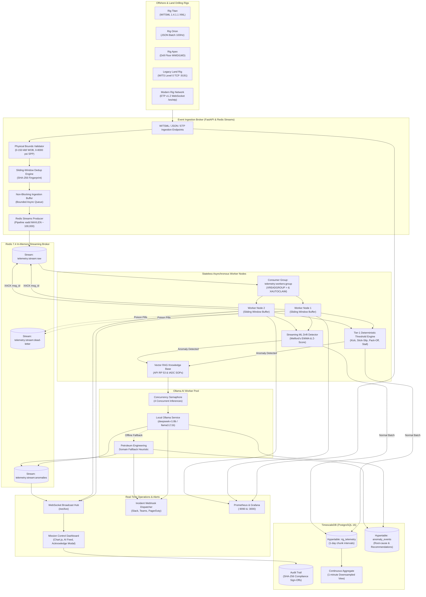

# Architecture

> Distributed, event-driven streaming topology decoupling real-time WITSML rig sensor ingestion from asynchronous AI inference workers.

## Core Principles

1. **Local-First & Air-Gapped by Default**:
   All sensor parsing, physics calculations, time-series storage, and LLM inference run entirely within the perimeter on owned rig or edge-node hardware. Zero telemetry leaves the private network.

2. **Decoupled Asynchronous Streaming**:
   High-frequency 50–100 Hz rig telemetry cannot block on neural network inference. Redis Streams acts as an elastic buffer, isolating ingestion latency from inference latency.

3. **Two-Tier Safety Architecture**:
   - **Tier 1 (Sub-millisecond Physics & ML)**: Deterministic physics thresholds evaluate every single sample in 42 µs ($>21,000$ ev/s).
   - **Tier 2 (AI Root-Cause Reasoning)**: Only anomalous sensor windows are dispatched to the Ollama pool, grounded with vector RAG against API RP 53 well control guidelines.

4. **At-Least-Once Delivery with Idempotency**:
   Redis Streams Consumer Groups track unacknowledged messages via Pending Entries Lists (PEL). Stale messages from crashed workers are reclaimed automatically via `XAUTOCLAIM`, while incoming duplicate frames are filtered via SHA-256 fingerprinting.
